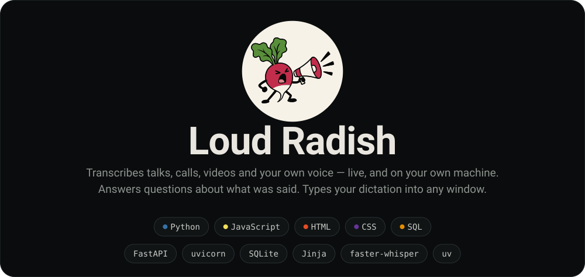
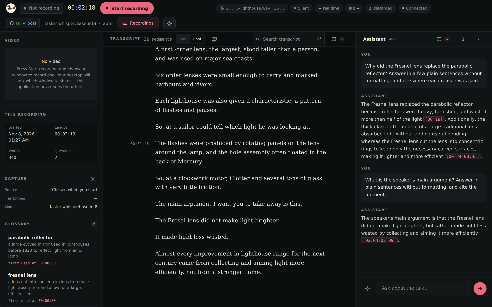
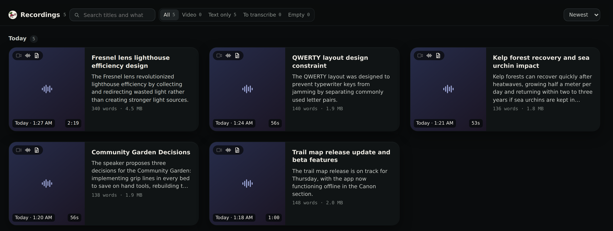
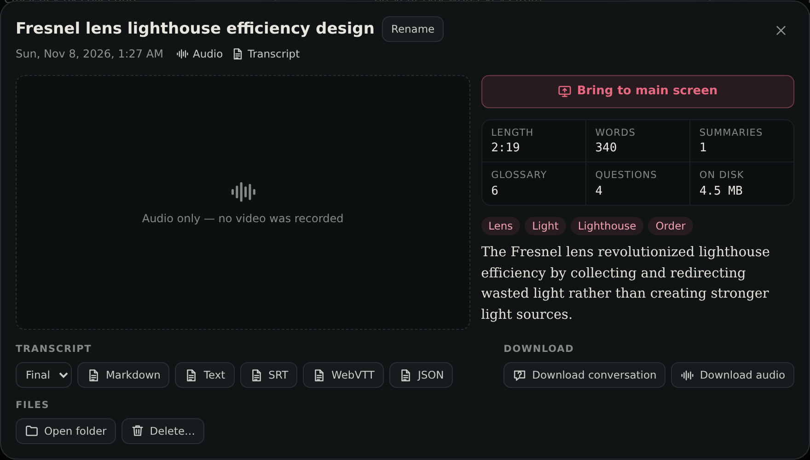
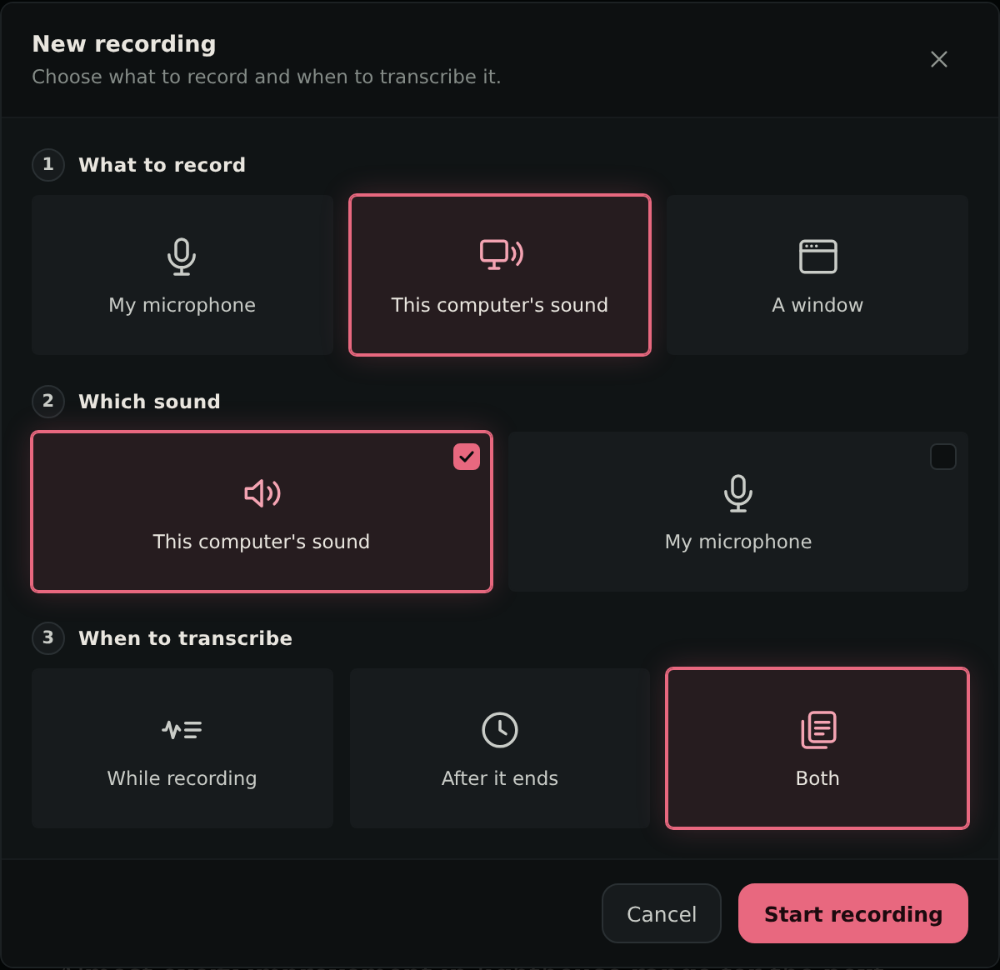
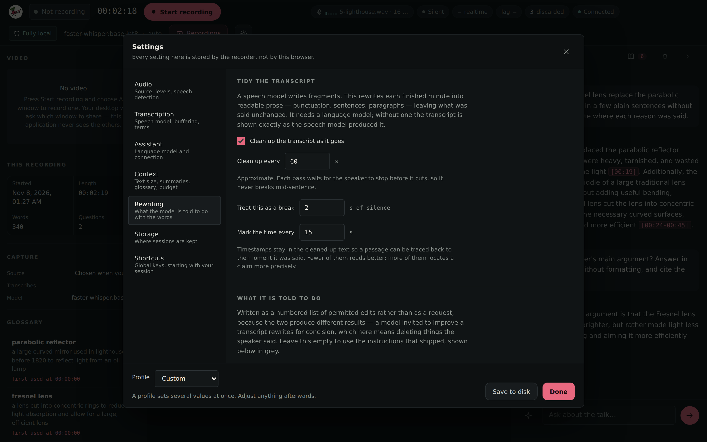

<p align="center">
  
</p>

<!-- The banner is generated: `uv run docs/assets/make_header.py` redraws it from the mark in
     `web/frontend/static/brand/radish.svg`. Its two tagline lines condense the paragraph below,
     so if that paragraph changes, edit TAGLINE in the generator and re-run it. -->

**Records what your computer can hear, transcribes it on your own machine, and lets you ask
questions about it.** Point it at a microphone, at whatever your speakers are playing, or at a
window on your desktop: a talk, a meeting, a call, a video. Read along as it is said, get a more
accurate second pass when it ends, and ask questions that are answered with timestamps you can
click. Or press a shortcut, speak, and have the tidied text typed into whatever window you were in.
Nothing is uploaded.

<p align="center">
  
</p>

> **Status:** working and in daily use, built solo since August 2026. **Linux only**: capture goes
> through PipeWire and the desktop's screen-cast portal. Single user, bound to loopback, no
> authentication. What has and has not been confirmed on real hardware is recorded in
> [docs/checklist.md](docs/checklist.md).

## What it does

**Record**

- **One sheet for every recording.** *Start recording* asks what to record (your microphone, this
  computer's sound, or a window, with its video if you want it) and when to transcribe: while
  recording, after it ends, or both. It remembers your answers.
- **Two sounds at once.** A window's sound and your microphone together, each with its own volume
  and mute while you record, so a call keeps both sides.
- **Window video that survives resizing.** Every frame is fitted to one fixed canvas, so moving or
  resizing the window never breaks the file.

**Read and ask**

- **A live transcript you can trust.** Text that has been committed never changes. The uncertain
  tail is drawn separately until the model is sure of it.
- **An assistant that answers from the transcript only.** It cites the moments it draws on as
  timestamps you can click, and when the speaker did not cover something the answer says so. Five one-click questions:
  summarise the last ten minutes, the main argument, define recent terms, what did I miss, and
  explain the last point simply.
- **A glossary and rolling summaries** that build themselves as the talk goes on, and an optional
  polish into readable paragraphs whose instructions you can edit.

**Keep and revisit**

- **A Recordings page** of cards grouped by day, each titled by the language model, with frames
  from the video, search and filters.
- **Bring any recording back** to the main screen and keep asking about it. One that was never
  transcribed can be, once you approve it.
- **Exports:** the transcript as Markdown, SRT or JSON, the conversation on its own, video as MP4
  in five presets, and a self-contained web page that opens with no server.

**Beyond the browser**

- **Push-to-talk dictation.** A global shortcut records you, tidies the words, and types them into
  the focused window.
- **A tray icon and global shortcuts** that show what is recording and start or stop it without
  opening the browser.
- **No config file.** Every setting is in the app: audio, the speech model, the assistant,
  context, rewriting, storage and shortcuts.

<table>
<tr>
<td width="50%">

<p><em>Every recording, named by the model and grouped by day.</em></p>
</td>
<td width="50%">

<p><em>One window per recording: bring it back, read it, or export it.</em></p>
</td>
</tr>
<tr>
<td width="50%">

<p><em>What to record, and when to transcribe it.</em></p>
</td>
<td width="50%">

<p><em>What the language model is told to do is a setting, not code.</em></p>
</td>
</tr>
</table>

## Run it

Requires Python 3.11+ on Linux and [`uv`](https://docs.astral.sh/uv/). There is no Node toolchain
and no build step.

```bash
uv sync && uv run app.py
```

Then open <http://127.0.0.1:8395>. Out of the box it uses a **scripted mock speech model**, so the
whole interface works before any model weights are downloaded. Choose a real model in
**Settings → Transcription** and your microphone in **Settings → Audio**, where **Test this
device** tells you whether the input is producing usable audio.

Run the checks with `uv run pytest && uv run ruff check .` (2,492 tests). Nothing in that run talks
to a real language model unless you pass `--run-live-llm`.

## How it fits together

```text
microphone / computer sound / window
    ▼  audio capture — 16 kHz mono, several inputs mixed, never blocking
    ▼  voice activity detection — speech, pauses
    ▼  streaming engine ◄──► speech model   (faster-whisper, in its own process)
    ▼  transcript store — SQLite, append-only
    ▼  HTTP for operations, WebSocket for the live stream
    ▼  browser — committed text, and the tentative tail shown apart from it
```

The speech model and the language model are both swap points: the first is a setting, and the
second can be a local server or a hosted API. [docs/architecture.md](docs/architecture.md) explains
both.

## Privacy

With a local speech model and a local language model, no audio and no text leaves the machine, and
the header says so. The server binds to `127.0.0.1` because it has no authentication. The
screenshots above use made-up talks read by a speech synthesiser, never a real recording; see
[docs/assets/README.md](docs/assets/README.md).

## Documentation

`docs/` is the single source of truth. Start with
[docs/documentation.md](docs/documentation.md) (purpose, stack, decision log) and
[docs/workflow.md](docs/workflow.md) (every command), then [docs/checklist.md](docs/checklist.md)
for what is done and what is not. [docs/structure.md](docs/structure.md) explains the layout.

AI agents must read [docs/skills/global-project-rules/SKILL.md](docs/skills/global-project-rules/SKILL.md)
before making changes; the pointer files in `.claude/`, `.agents/` and `.cursor/` route back to it.

## Licence

[MIT](LICENSE).
